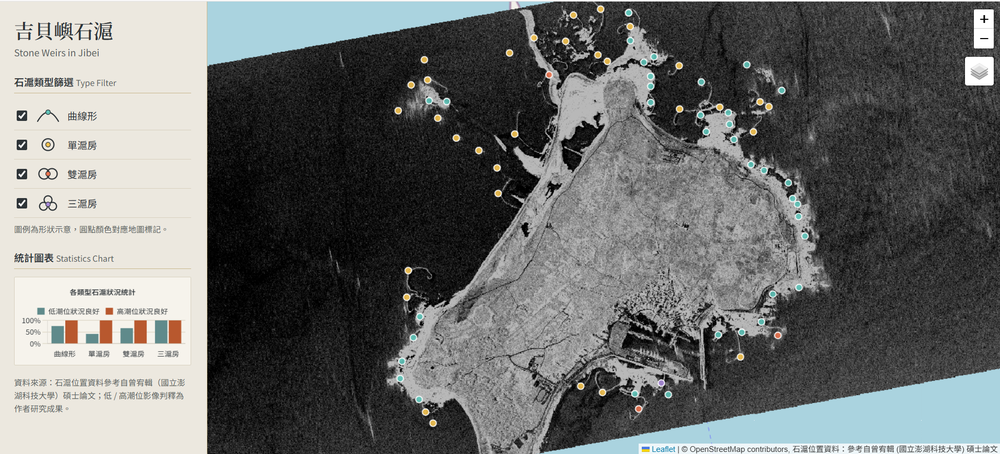

# 澎湖吉貝石滬互動地圖平台 (Stone Weirs Platform)

整合 SAR 影像研究成果的 Web GIS：在互動式地圖上瀏覽澎湖吉貝嶼 **72 座石滬**，依類型篩選，並查看在小潮低潮 / 高潮影像下的露出狀況統計。

石滬位置資料的來源請見下方「資料來源」。



## 功能

- 地圖上以不同顏色標示四種石滬類型（曲線形、單滬房、雙滬房、三滬房）
- 依類型篩選，統計圖表同步更新
- 切換「小潮低潮 (MLWN)」與「小潮高潮 (MHWN)」影像圖層
- 點擊石滬查看編號、類型與低 / 高潮位狀況
- 支援手機版介面
- **REST API**：可查詢列表、單筆、附近石滬與統計

## 系統架構

```
瀏覽器 (Leaflet + Chart.js)
   │  fetch /api/weirs
   ▼
Flask (gunicorn) ── 同時提供前端靜態檔案 (public/)
   │  psycopg2
   ▼
PostgreSQL + PostGIS   (stone_weirs 資料表，geometry(Point, 4326) + GIST 空間索引)
```

這個專案原本是純前端（瀏覽器直接讀取 CSV），後來重構為有後端與資料庫的版本：
資料集中存放、可被其他程式與 GIS 軟體取用，查詢邏輯（篩選、分頁、空間距離）也由資料庫處理。

## API

| 方法 | 路徑 | 說明 |
|------|------|------|
| GET | `/api/weirs` | 石滬列表。參數：`type`、`mlwn_ok=true\|false`、`limit`、`offset` |
| GET | `/api/weirs/<id>` | 單一石滬詳細資料 (例如 `/api/weirs/PSTW398`) |
| GET | `/api/weirs/nearby?lat=&lng=&radius=` | 附近石滬，`radius` 單位為公尺，依距離由近到遠排序 |
| GET | `/api/stats` | 各類型的數量與狀況良好的數量 |

錯誤回應格式一致：`{"success": false, "error": "說明"}`，並使用合適的狀態碼 (400 / 404 / 503)。

## 資料庫設計

`stone_weirs`：每列一座石滬，座標存為 PostGIS `geometry(Point, 4326)` (WGS84)。

- `GIST` 索引加速空間查詢
- 另建 `geography` 運算式索引，用於以「公尺」計算的 `ST_DWithin` / `ST_Distance`
- `mlwn_ok` / `mhwn_ok` 在匯入時由原始欄位計算並存為布林值，查詢統計不必每次字串比對

資料以 `scripts/import_csv.py` 從 CSV 匯入（可重複執行，已存在的資料會被更新）。
**原始 CSV 不包含在這個 repo 中**（見「資料來源」）；測試使用 `tests/fixtures/` 內虛構的範例資料。

## 本機執行

### 方式一：Docker Compose

```bash
docker compose up --build -d
```
開啟 http://localhost:5000 。資料表一開始是空的；若要試用，可匯入範例資料：
```bash
docker compose run --rm -v "$PWD/tests/fixtures:/fixtures" web python scripts/import_csv.py /fixtures/sample_weirs.csv
```

### 方式二：直接用 Python

```bash
pip install -r requirements.txt
export DATABASE_URL=postgresql://使用者:密碼@主機:5432/資料庫   # 需要有 PostGIS 的 PostgreSQL
python scripts/import_csv.py tests/fixtures/sample_weirs.csv   # 範例資料；有自己的 CSV 就換成它的路徑
python app.py
```

## 測試

```bash
pip install -r requirements-dev.txt
export TEST_DATABASE_URL=postgresql://使用者:密碼@localhost:5432/測試用資料庫
pytest
```

測試涵蓋：匯入的重複執行、空值處理、篩選與分頁、參數驗證、404 處理、空間距離查詢的排序與範圍、
以及後端原始碼與資料檔不會被當成靜態檔案公開。每次 push 由 GitHub Actions 自動執行。

## 部署

- 資料庫：Neon (PostgreSQL + PostGIS)，連線字串設為環境變數 `DATABASE_URL`
- 網站：Render (Docker)，同一個 `DATABASE_URL`
- 首次部署後，在本機執行 `DATABASE_URL=... python scripts/import_csv.py <CSV路徑>` 把資料匯入雲端資料庫

## 資料來源

- **石滬位置資料**：參考自曾宥輯（國立澎湖科技大學）之碩士論文。
  曾宥輯. (2024). 澎湖石滬群的類型與數量之研究. 國立澎湖科技大學觀光休閒系碩士論文.
- 原始資料集**不隨本專案公開散布**：repo 不含原始 CSV，API 也不提供整份資料的下載格式（如 GeoJSON）。
  網站僅在地圖上顯示點位，並已標示來源。如需使用資料，請洽原作者。
- 低 / 高潮位影像圖層與狀況判釋為作者的研究成果。

## 已知限制與未來改進

- API 目前為唯讀且沒有身分驗證；若要開放資料編輯，需加入認證與輸入驗證
- 石滬點位以點表示；尚未儲存每座石滬的實際多邊形外形（滬堤、滬房）
- 地圖圖磚以靜態檔案由 Flask 提供；流量變大時應改由 CDN 或物件儲存提供
- 前端尚未使用 `/api/stats` 與 `/api/weirs/nearby`（目前由前端自行計算統計）

## 技術

Python 3.11 · Flask · gunicorn · PostgreSQL / PostGIS · Leaflet · Chart.js · Docker · pytest · GitHub Actions
